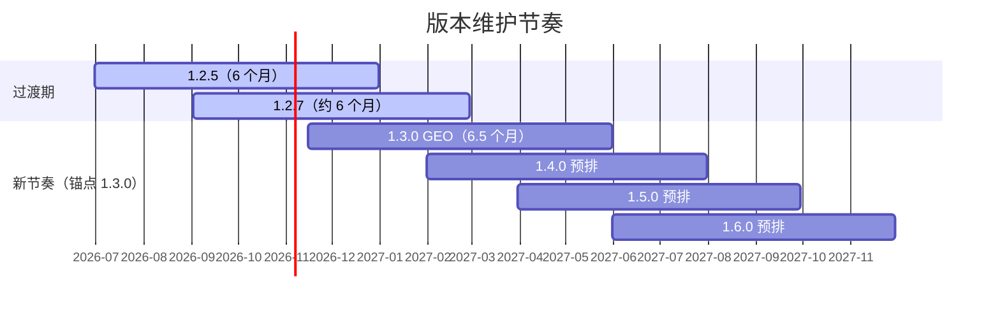

# opendesign-components

基于 Vue 3 的企业级组件库，包含组件包、构建 CLI 和文档站。

## 快速上手

```bash
# 克隆仓库
git clone https://atomgit.com/openeuler/opendesign-components.git
cd opendesign-components

# 安装依赖 + 编译组件 + 生成 API 文档（一键初始化）
pnpm docs:install

# 启动文档站开发服务器
pnpm docs:dev
```

浏览器访问 http://localhost:3300

## 项目架构

基于 pnpm workspace 的 monorepo：

| 包                      | 路径                  | 说明                |
| ----------------------- | --------------------- | ------------------- |
| `@opensig/opendesign`   | `packages/opendesign` | 发布的 Vue 3 组件库 |
| `@opensig/open-scripts` | `packages/scripts`    | 组件库专用构建 CLI  |
| docs                    | `packages/docs`       | 文档站 + 组件测试   |

## 版本策略

组件库遵循语义化版本 `MAJOR.MINOR.PATCH-SUFFIX`，并按以下节奏发布与维护：

- **发布节奏**：每 2 个月发布一个新 MAJOR.MINOR，发布日为当月最后一个工作日；若发布窗口无 feature，则该版本取消，版本号由下一个实际发布的版本顺延使用（不跳号）。
- **维护周期**：每个 MAJOR.MINOR 维护 6 个月；EOL 当天截止维护，同日发布的新版即时接管。
- **补丁节奏**：每月月中为补丁发版节点（弱规定，当月无需求可跳过），避免补丁发版无时间规律；常规补丁以 PATCH 递增（如 `1.3.0 → 1.3.1`）；发版计划按「前一月定后一月」滚动确定。
- **紧急补丁**：安全漏洞或阻断主流程的补丁不受月中节点约束。
- **并行水位**：最多 3 个 MAJOR.MINOR 并行维护；版本取消时当期少于 3。
- **MAJOR 版本**：破坏性变更（如 2.0.0）占用最近的常规发布窗口，不临时加塞；MAJOR 变更后 MINOR 自 0 重新计数，节奏不重置。
- **SUFFIX 槽位**：`-SUFFIX` 仅在例外场景启用（正常不使用），需要时另行讨论口径。

### 过渡期方案

| 版本  | 处理                                                           |
| ----- | -------------------------------------------------------------- |
| 1.2.5 | 现行主力，2026/06/30 首发，EOL 2026/12/31                      |
| 1.2.6 | 无主要使用方，新方案启动后停止维护，引导迁移至 1.2.7-x         |
| 1.2.7 | 现行主力，2026/09/02 首发，EOL 2027/02/28                      |
| 1.3.0 | GEO 优化版本，2026/11 中旬发布，作为新节奏锚点，EOL 2027/05/31 |

自 1.3.0 起按上述节奏递推（1.4.0 预排 2027/01，1.5.0 预排 2027/03，1.6.0 预排 2027/05）：



完整可视化（甘特图 + 并行版本数水位图，含每月月中补丁节点）见 [版本维护节奏图](./packages/docs/public/versioning.html)，亦可在文档站导航栏进入「版本策略」页面查看。

## 变更日志

- [opendesign 变更日志](./packages/docs/ReleaseNote.opendesign.md)
- [open-scripts 变更日志](./packages/docs/ReleaseNote.scripts.md)

## 参与贡献

1. Fork 本仓库
2. 基于 release/xxx 分支，新建 feat/xxx 分支
3. 提交代码到 fork 仓
4. 新建 PR 合入到主仓 release/xxx 分支
